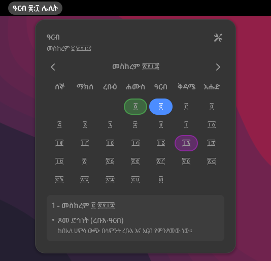

<div align="center" style="margin-bottom: 40px;">
  <h1>EthCal GNOME Extension</h1>
</div>

<p align="center" style="margin-bottom: 30px;">
  
</p>

<p align="center" style="margin-bottom: 30px;">
  <a href="https://github.com/dagimg-dot/EthCal/releases/latest">
    
  </a>
  <a href="https://github.com/dagimg-dot/EthCal/releases">
    
  </a>
</p>

<p align="center">
  The Ethiopian calendar in your GNOME top bar
</p>

<p align="center">
  
</p>

## Features

- Today's Ethiopian date in the top bar, on the left, center or right
- A month calendar with public, religious and cultural holidays and fasting periods
- Amharic or English, with optional Geez numerals
- Your own top bar format from tokens like `dday, mnam dd, year hh:mm`, with a token reference in the settings
- A month and year picker to jump to any date

Works on GNOME 48 to 51.

## Installation

Install the latest release with one command:

```bash
curl -fsSL https://raw.githubusercontent.com/dagimg-dot/EthCal/main/scripts/install.sh | bash
```

Or by hand:

1. Download the `.shell-extension.zip` from the [latest release](https://github.com/dagimg-dot/EthCal/releases/latest)
2. Install it with `gnome-extensions install --force <filename>`
3. Log out and back in
4. Enable EthCal in the Extensions app

## Development

See [DEVELOPMENT.md](./DEVELOPMENT.md).

## License

MIT. See the [license](./LICENSE) for details.
